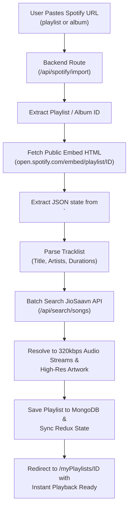
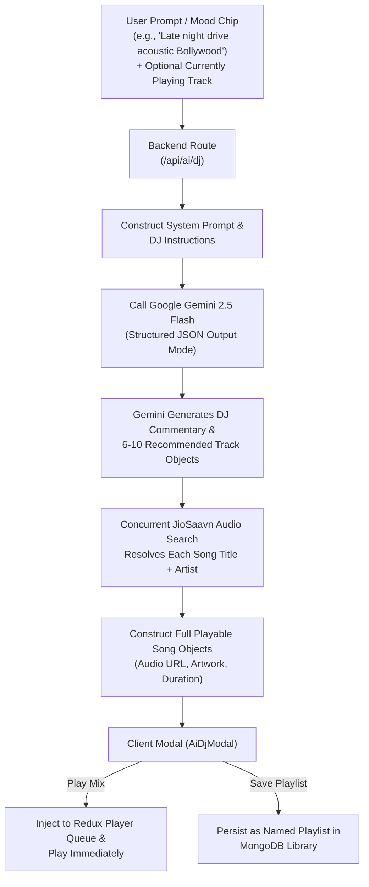

This is a free music streaming web application built with Next.js and powered by the [savan API](https://github.com/sumitkolhe/jiosaavn-api). The app allows users to search and stream music from a vast collection of songs available on the Saavn platform.

## Features
* Search and stream music from vast collection.
* Play, pause, skip, and control the playback of songs.
* Create your own playlists.
* **Spotify Playlist Importer**: One-click import from any public Spotify playlist or album link with automatic song resolution (zero developer credentials required).
* **AI Music DJ (Google Gemini 2.5 Flash)**: Conversational vibe and mood-based music curator that generates playable tracklists on the fly.
* **Interactive Floating AI Mascot**: Cyber-DJ assistant floating across the application for instant vibe curation.
* Add songs to your favorite.
* Auto add similar songs to queue.
* Display song details such as title, artist, album, and album artwork.
* Responsive and mobile-friendly design for a great user experience.
* Minimalistic and intuitive user interface.

## Architecture & Data Flows

### 1. Spotify Playlist Importer (Zero-Credential Architecture)

Users can paste any public Spotify playlist or album URL (`https://open.spotify.com/playlist/...`). The system imports the entire tracklist without needing Spotify OAuth tokens or developer client secrets.



#### Why it works without a Spotify API Key:
- Spotify's public embed player (`open.spotify.com/embed/...`) is a server-side rendered Next.js application.
- Next.js injects its pre-rendered state inside a `<script id="__NEXT_DATA__">` JSON block in the raw HTML.
- Our backend extracts this JSON directly, parses all song titles and artists, and then queries the JioSaavn audio database to deliver playable 320kbps streams without DRM restrictions.

---

### 2. AI Music DJ Flow (Google Gemini 2.5 Flash)

The AI Music DJ blends generative AI intelligence with streaming audio discovery to curate tailored sets based on moods, genres, or currently playing songs.



---

### 3. Floating AI Mascot Companion

- Located at the bottom-right corner of the application above the playback bar.
- Features dynamic animated SVG headphones, neon equalizer visor, responsive speech bubble notifications, and idle hover animations.
- Provides one-click access to summon the AI DJ modal from any page in the app.

---


## Screenshots

### Home Page
Bilingual Hindi & English trending tracks, Quick Access cards, live Liked Songs badge, and one-click New Playlist creation.


### Navigation Drawer & Multi-Language Preferences
Slide-out drawer featuring official Musify branding, user profile, custom playlists, and multi-language selection.


### Trending Songs & Trending Albums Sliders
Dual independent carousels organizing trending songs and trending albums in high-fidelity cards.


### Search Experience
Real-time search across songs, albums, and artists with instant playback support.


### Liked Songs (Dedicated View)
Single official Liked Songs page featuring Neon Rose gradient hero banner, live song count, and row-level heart toggles.


### Curated Playlist & Bulk Downloader
Full playlist view with high-res artwork, Lossless 320kbps playback, and one-click ZIP bulk downloader.


### Fullscreen Music Player (Queue View)
Immersive full-screen playback with dynamic ambient lighting, upcoming track queue, and lossless controls.


### Time-Synced Lyrics
Real-time synchronized karaoke lyrics with dynamic highlight tracking.


***

This is a [Next.js](https://nextjs.org/) project bootstrapped with [`create-next-app`](https://github.com/vercel/next.js/tree/canary/packages/create-next-app).

## Getting Started

First, run the development server:

```bash
npm run dev
# or
yarn dev
# or
pnpm dev
```

Open [http://localhost:3000](http://localhost:3000) with your browser to see the result.

You can start editing the page by modifying `app/page.js`. The page auto-updates as you edit the file.

This project uses [`next/font`](https://nextjs.org/docs/basic-features/font-optimization) to automatically optimize and load Inter, a custom Google Font.

## Deploy on Vercel

The easiest way to deploy your Next.js app is to use the [Vercel Platform](https://vercel.com/new?utm_medium=default-template&filter=next.js&utm_source=create-next-app&utm_campaign=create-next-app-readme) from the creators of Next.js.
